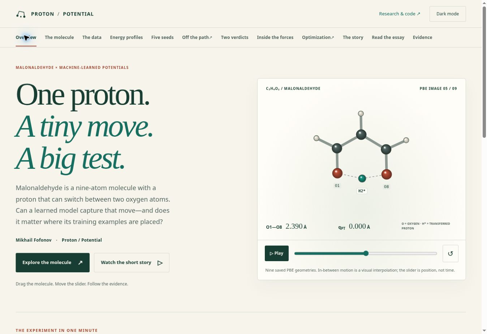

# Опубликованная популярная редакция: финальная приёмка

Сайт: https://spicmaff.github.io/malonaldehyde-transition-sampling/#overview

Финальный код: [`1ab58ddc400cd3290ea652cca92c74554b519dd8`](https://github.com/spicmaff/malonaldehyde-transition-sampling/commit/1ab58ddc400cd3290ea652cca92c74554b519dd8).
Дерево: `a18ec1c3099ee7487edbe57760a0bf982191f2ab`.
Чистая рабочая копия, без незарегистрированных исходников. Проверка и развёртывание
[GitHub Actions 39885246185](https://github.com/spicmaff/malonaldehyde-transition-sampling/actions/runs/39885246185) завершились успешно.
Все **54 опубликованных runtime-ресурса** побайтно совпали с чистой сборкой этого commit.
Проверены HTML, JavaScript, CSS и загружаемые данные, а не только исходный HTML.

Популярная публикация готова в пределах описанных проверок. Это не утверждение
о полной физической валидации всех исследований.

## Что изменилось для читателя

- Первый экран объясняет малональдегид и перенос протона. Молекула видна сразу,
  в том числе на узком экране; есть подписи атомов и ручное управление.
- Новая диаграмма сравнивает три исходных энергетических профиля на общих осях,
  с разными маркерами и стилями линий. Её смысл доступен без анимации.
- Эссе сокращено примерно до 1950 слов, страница и Markdown-загрузка используют
  один текст. Архивные инвентаризации и повторяющиеся служебные статусы убраны
  из основного чтения; существенные ограничения сохранены рядом с выводами.
- Optimization начинается с наглядного объяснения остатка, штрафа и Q.
  Численные детали и исторические диагностики доступны в раскрываемых блоках.
- Исправлены ссылки выбора кадра и атома сил, статическая геометрия и числа,
  научные ссылки воспроизведения, контраст светлых H и доступные описания сцен.
  Научные массивы и историческое происхождение результатов сохранены.

[Полный отчёт с доказательствами, численными пересчётами, командами и сравнениями до/после](../e046584c4c1fc2ce93347e4a60973c0ed23a3313/REVIEW_RU.md).
Это исторический отчёт предыдущего commit; настоящее дополнение фиксирует
последнее исправление и проверки финальной публикации.

## Последняя подтверждённая неточность

В опубликованной версии `e046584c` после выбора первого кадра доступное имя
внешнего контейнера сцены сохраняло «saved PBE image 5 of 9». Видимая подпись
и сама выбранная геометрия были правильными, но скринридер получал неверный номер.

Исправление: контейнер теперь называется «selected molecular geometry»;
точный текущий кадр указан рядом. Статическое SVG сохраняет правильное описание
собственной исходной геометрии, а force viewer продолжает обновлять точный
кадр и атом. Проверка на опубликованном `1ab58ddc400c`: Home на ползунке →
«Saved image 1 / 9», доступное имя без устаревшего номера. Доказательства:
`BEFORE_ACCESSIBLE_NAME.json` и `AFTER_ACCESSIBLE_NAME.json`.
Добавлена регрессионная проверка. Между этими двумя commit изменились только
`site/pages.py`, тест и запись манифеста; JS, CSS и научные данные не менялись.

## Проверки и границы

Для финального commit: **209 Python-тестов, 30 статических проверок сайта,
35 JavaScript-тестов — PASS**. Пять основных браузерных сценариев — PASS,
включая 120 сочетаний 12 маршрутов, пяти ширин (320, 390, 768, 1440, 1920 px)
и двух тем; ссылки сил, перезагрузку, Back/Forward, ручной выбор S1,
остановку анимаций, reduced motion и статическую сцену без JavaScript.

Расширенная приёмка доступности и cinematic-сценариев ранее прошла на
`3a83c4c04c5ec6c02cd4bbc2e4e19c44ae9eb796`, run 39882036929. Её источник и
последующие изменения разграничены в `CI_TEST_SUMMARY.json` и полном отчёте.
Прежний сценарий Optimization Play → S1 прошёл; гонка ожидания reduced motion
в новом тесте исправлена ожиданием фактического состояния интерфейса.

В финальной опубликованной версии вручную подтверждены описание выбранного кадра,
идентификатор сборки и первый экран. Для других интерактивных состояний сохранены
проверки предшествующей редакции и повторные основные сценарии финального CI.
Реальные мобильные устройства, фактические скринридеры и весь диапазон
аппаратных GPU не сертифицированы. SVG contrast incomplete оценивались
по исходной палитре и выбранным отрисованным состояниям; это не полная
сертификация WCAG.

Существенные научные границы остаются: фиксированные выборки и пять повторений
обучения не означают независимую генерацию данных; development не является
holdout; геометрический разрыв не доказывает экстраполяцию в признаках MTP.
Арифметика опубликованных агрегатов Optimization не заменяет новый native replay.
Новых квантовых расчётов, экспорта COV-кандидата и исследований сходимости не выполнено.

## Файлы доказательств

- `SOURCE_IDENTITY.json`, `CHANGE_SCOPE.json`: исходники и точная область изменения.
- `PUBLISHED_RESOURCE_PARITY.json`: хеши и HTTP-результаты всех 54 ресурсов.
- `PYTHON_TESTS.log`, `SITE_TESTS.log`, `JS_TESTS.log`: локальные проверки.
- `SITE_CHECK_JOB.log`, `CI_TEST_SUMMARY.json`: финальный CI.
- `WORKFLOW_JOBS.json`, `WORKFLOW_ARTIFACTS.json`: успешные задания и source-bound artifacts.
- `BEFORE_ACCESSIBLE_NAME.json`, `AFTER_ACCESSIBLE_NAME.json`: воспроизведение последнего дефекта.
- `SHA256SUMS`: контрольные суммы этого дополнения.

Сборка: `python -B tools/build_research_site.py --out _site`.
Тесты и научные проверки перечислены в полном отчёте. Временный каталог тестов
следует располагать вне checkout, например
`TMPDIR=/path/outside/checkout python -B -m unittest discover -s tests -q`,
чтобы локальные временные файлы не меняли build identity.

## Оставшиеся исследовательские вопросы

1. Как изменится результат при покрытии релаксированного пути и сжатия O–O,
   с независимой генерацией обучающих выборок?
2. Сохраняются ли выводы на заранее отложенных геометриях без общих endpoint
   и участия в адаптивном выборе?
3. Как сходятся барьер и путь по cutoff, размеру ячейки, дискретизации NEB
   и уровню электронной модели?
4. Даст ли экспортированный COV-кандидат native energy/force parity и выигрыш
   на внешних силах при сопоставимой стоимости обучения?
5. Какой расчёт ядерной динамики нужен для обоснованных выводов о splitting
   или скорости реакции?

Первый экран финальной публикации:

