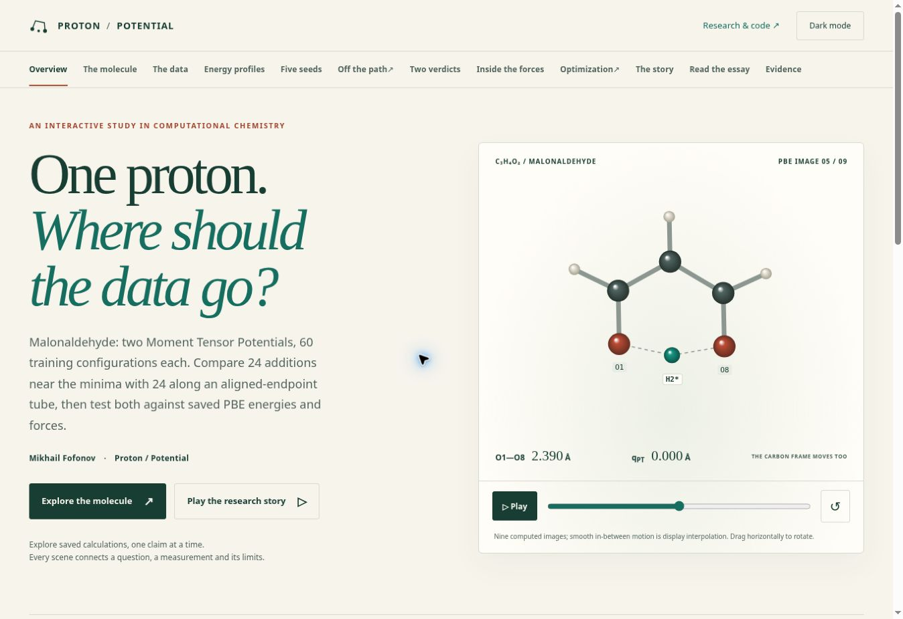
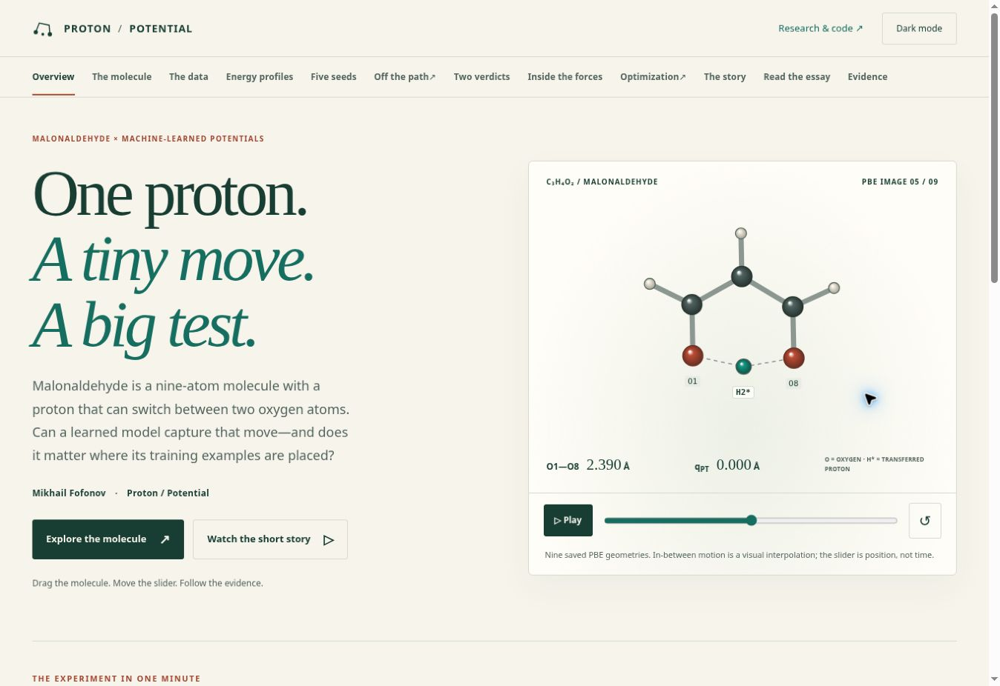
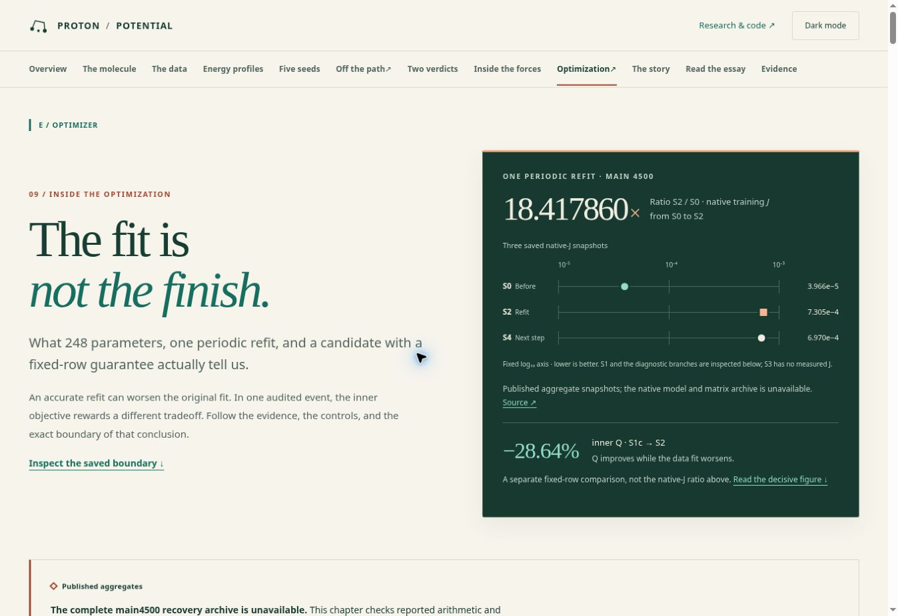
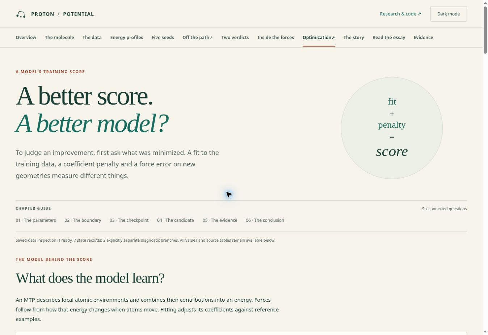
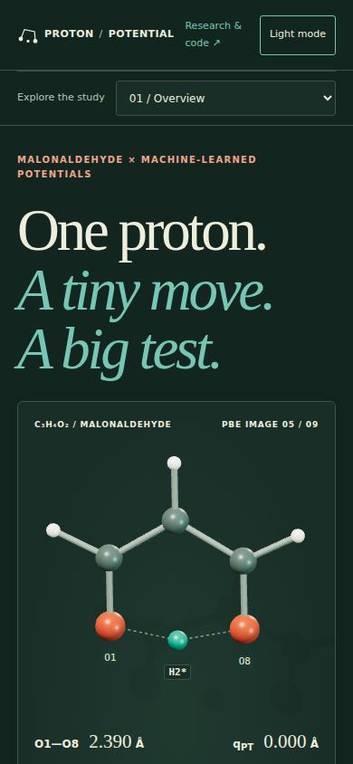
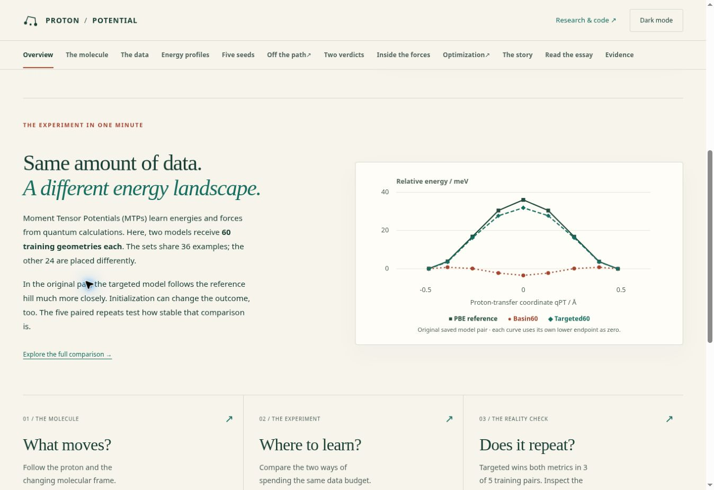

# Приёмка популярной редакции Proton / Potential

Проверяемая исходная публикация: `51c96a7034567006b803a92124b67e2333ba7b4e`.
Редакция: `e046584c4c1fc2ce93347e4a60973c0ed23a3313`.
Публичный адрес: https://spicmaff.github.io/malonaldehyde-transition-sampling/

Цель этой редакции — понятное популярное представление существующих исследований.
Она исправляет подтверждённые дефекты и меняет изложение, а не создаёт новые
результаты вычислительной химии. Заключение о публикации и результаты развёртывания
приведены в соседнем `README.md` после завершения проверок.

## Подтверждённые дефекты и исправления

| Приоритет | Место | Доказательство в исходной версии | Исправление и критерий проверки |
|---|---|---|---|
| P1 | `site/app.mjs`, выбор сил | При выборе Replay 93 / O8 интерфейс показывал новый кадр, но ссылка сохраняла `frame=145&atom=1`; перезагрузка возвращала другой результат. | Кадр и атом записываются в текущую запись истории. Перезагрузка и пересылка ссылки восстанавливают выбор; Back/Forward работают между разделами. |
| P1 | `site/pages.py`, статическая молекула сил | Все сцены получали центральную PBE-геометрию. Подпись force viewer обещала Replay 145, а числа оставались пустыми до JavaScript. | SVG использует именно Replay 145; выбран H2*, заполнены таблица компонентов, ошибка атома и RMSE 0.02781 эВ/Å; выбран тот же пункт списка. |
| P2 | SVG, доступные имена | Описание любой геометрии называло её центральной PBE, включая PBE14. | Нейтральное описание по умолчанию и конкретное для force viewer. При интерактивном выборе сил обновляется доступное имя с кадром и атомом. |
| P2 | Ссылки воспроизведения | Train60 и five-seed карточки ссылались на верификатор Train119. | Train60 ведёт к пересчёту первичных метрик, seed-аудит — к соответствующему общему аудиту; Train119 сохраняет собственный верификатор. |
| P2 | Светлые атомы H | Заливка `#eee9dd` почти сливалась с фоном `#fffdf7` в статическом SVG; обводка повторяла фон. | Контрастная обводка атомов SVG и светлых H в Canvas; обозначены O1, H2*, O8. Проверяются обе темы. |
| P1 | Optimization, сила утверждений | Повествование местами представляло опубликованные сводки как непосредственно проверенный native replay. | Возле диаграммы прямо указано, что это арифметика опубликованных сводных значений. Она не выдаётся за новое выполнение или доказанное улучшение внешних сил COV. |

## Подача и дизайн

Первый экран объясняет, что это малональдегид, какие атомы участвуют и зачем
сравнивать размещение обучающих примеров. Добавлена диаграмма трёх исходных
энергетических профилей: все девять сохранённых опор, общие оси, разные маркеры
и стили линий. Она показывает научную мысль: одинаковый бюджет не гарантирует
одинаковую форму энергетической поверхности вдоль выбранного пути.

На телефоне сцена видна сразу после заголовка, до подробного объяснения. Основной путь чтения ведёт от движения протона к данным и повторению обучения.
Служебные архивные инвентаризации, процессные оговорки и повторяющиеся внутренние
статусы убраны из этого пути. Существенные ограничения находятся рядом с выводами.
Исторические файлы результатов и их происхождение сохранены.

Optimization теперь начинается с понятного вопроса о смысле «лучшего» результата.
Столбики разлагают Q на остаток и штраф, не меняя чисел или масштаба. Состояния
native J, коэффициентный атлас, точные значения и дополнительная математика
доступны в раскрываемых пояснениях. Эссе сокращено примерно до 1950 слов;
страница и Markdown-загрузка используют один текст. Содержимое HTML уменьшилось
с 387010 до 301305 байт.

## Научные определения и пределы

- Train60 — две фиксированные выборки по 60 геометрий: 36 общих и 24 разных.
  Исходные случайные seed не были записаны; результат одной пары не изолирует
  эффект размещения примеров от инициализации. Вводная фраза не обещает такого
  причинного разделения. Пять seed повторяют оптимизацию этих выборок, а не генерацию пяти новых наборов.
- Минимальное O–O в обеих Train60: 2.4789906787485156 Å; в центральном PBE:
  2.390121851 Å. Все семь внутренних опор находятся ниже обучающего диапазона
  по этому дескриптору. Endpoint-linear tube не переименован в релаксированный NEB.
  Геометрический разрыв не назван доказанной экстраполяцией в признаках MTP.
- На девяти сохранённых опорах Basin60 даёт центральное понижение энергии,
  а PBE — повышение. Это не утверждение о минимуме полной 21-мерной внутренней PES.
- Исходный дискретный PBE-барьер 36.072093892926205 мэВ; абсолютные ошибки барьера
  Basin60 и Targeted60 — 35.245734070031176 и 4.10039360394876 мэВ. Эти цифры
  не объявлены точностью относительно эксперимента.
- PBE14 сохраняет обе модели, оба бюджета, четыре направления и пять seed.
  Основные веса равны для четырёх физических блоков; пары ± усредняются внутри
  блока. Альтернативные веса отделены как дополнительный анализ.
- Переходная средняя ошибка Basin меняется с 0.1877508856082289 до
  0.30989016220618243 эВ/Å, Targeted — с 0.16755708347341375 до
  0.16375476294700583. Расширение разрыва преимущественно связано с ростом Basin;
  это арифметическое разложение, не доказанный механизм обучения.
- Train119 остаётся адаптивной development-проверкой. Малые локальные ошибки
  на коррелированных кадрах не отменяют неудачу сохранённого критерия покрытия
  и не создают независимый holdout.
- Native J, fixed-row loss, Q и внешняя ошибка сил разделены. Условная гарантия
  COV предполагает фиксированные строки, пространство и метрику, допустимый
  нулевой шаг и неотрицательный штраф, равный нулю при нулевом шаге. При
  приближённом решении неравенство нужно проверять численно.
- Норма коэффициентной поправки зависит от параметризации. Предложение COV
  требует экспорта кандидата, native energy/force parity и внешней проверки,
  прежде чем можно будет говорить об улучшении модели.
- Настройки PBE/NEB приведены как документированные параметры, а не исследование
  численной сходимости. Электронный дискретный барьер, свободная энергия,
  спектральное расщепление и скорость реакции не отождествляются.

## Воспроизводимые проверки

```sh
python -B -m unittest discover -s tests -q
python -B tools/site/test_site.py
node --test tools/site/test_editorial.mjs tools/site/test_payload_validation.mjs tools/site/test_core.mjs
python -B tools/run_public_selftests.py .
python -B tools/audit_independent_science.py --out independent-science.json
python -B tools/verify_editorial_findings.py --check
python -B tools/build_research_site.py --out _site
```

В используемом локальном окружении временные каталоги направлялись через
`TMPDIR` за пределы рабочей копии: его системный каталог по умолчанию оказался
внутри checkout и менял счётчик untracked в build identity между сборками.
В чистой копии с внешним временным каталогом повторная сборка проходит проверку
побайтной детерминированности. Код сайта из-за этого ограничения среды не менялся.

Python: 209 тестов; статическая проверка сайта: 30; JavaScript: 35.
Соседние журналы и JSON фиксируют фактические результаты для указанного commit.
`SCIENTIFIC_CONTINUITY.json` подтверждает неизменность научных payload; различий
в `data/` между исходной публикацией и этой редакцией нет.

Основные браузерные сценарии дополнены проверкой 120 сочетаний 12 маршрутов,
пяти ширин (320, 390, 768, 1440, 1920 px) и двух тем. Проверяются ссылки выбора
сил, реальная перезагрузка, Back/Forward, optional reader, reduced motion и
статическая сцена без JavaScript. Существующие сценарии дополнительно проверяют
повреждённые payload, WebGL fallback, клавиатуру, доступность и остановку анимаций.

Локальный supervised preview недоступен: отсутствует mailbox службы
`sites-previewd`. Браузерная приёмка выполняется в штатном GitHub Actions CI;
после публикации проводится осмотр реального сайта. Это не сертификация реальных
мобильных устройств, скринридеров и всего диапазона аппаратных GPU.

## Оставшиеся исследовательские вопросы

1. Что изменится, если примеры будут покрывать релаксированный путь и сжатие O–O,
   а выборки будут независимо генерироваться для повторений?
2. Насколько выводы сохраняются на заранее отложенных геометриях без общих
   endpoint, соседних кадров и участия в adaptive development?
3. Как чувствительны PBE-барьер и структура пути к cutoff, размеру ячейки,
   дискретизации NEB и более точной электронной модели на согласованных геометриях?
4. Даст ли экспортированный COV-кандидат native parity и улучшение внешних сил
   в сравнении полных обучений с одинаковой стоимостью и checkpoint policy?
5. Если ставится задача о туннелировании или скорости, какой ядерный гамильтониан
   и какой независимо сходящийся расчёт нужны для соответствующей наблюдаемой?

## Идентичность расширенного прогона и финальной публикации

Расширенная матрица и контролируемые сравнения завершились успешно на
`3a83c4c04c5ec6c02cd4bbc2e4e19c44ae9eb796` (run 39882036929). Между ним и
опубликованным `e046584c4c1fc2ce93347e4a60973c0ed23a3313` изменились только
ожидание в новом browser test и его запись в манифесте. Все файлы сайта,
генераторы и научные данные идентичны. Для опубликованного commit отдельно
прошли пять основных браузерных сценариев, включая матрицу 120 состояний
и переключение reduced motion во время работающей анимации (run 39882769417).

Промежуточный сбой был гонкой теста: подтверждение CDP-эмуляции не означало,
что обработчик MediaQueryList уже обновил disabled у кнопки. Проверка теперь
ожидает фактического состояния, проверяет восстановление управления после
снятия настройки и остановку уже запущенной анимации. Это исправление теста;
код интерфейса для него не менялся. Отдельный прежний сценарий Optimization
с переходом S0 → S1 прошёл с фактическим попаданием в кнопку Play.

54 опубликованных runtime-ресурса побайтно совпадают с чистой сборкой
финального commit. Полный результат: `PUBLISHED_RESOURCE_PARITY.json`.
Сводка CI и запись фактического Play/S1: `CI_TEST_SUMMARY.json`. Полные
машиночитаемые отчёты сохранены в `BROWSER_REPORTS.json.gz`.

## Контролируемые сравнения опубликованного сайта

Одинаковые viewport 1348 × 922 px, светлая тема, сохранённая PBE-геометрия 5/9.

До:



После:



Optimization до:



Optimization после:



Телефон, 390 px, тёмная тема — молекула на первом экране:



Новая сводная диаграмма на опубликованной странице:


